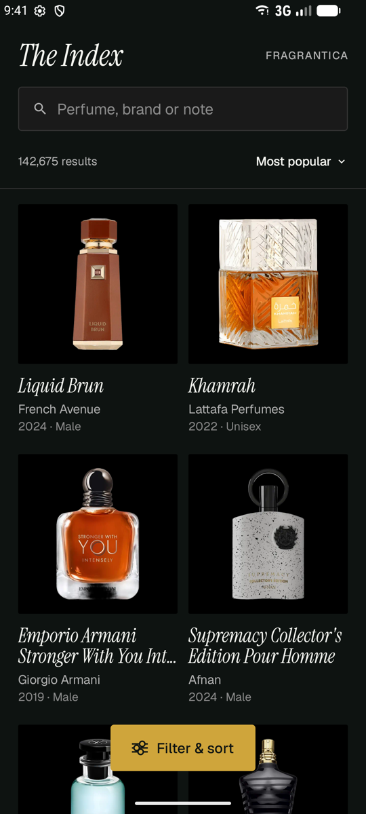
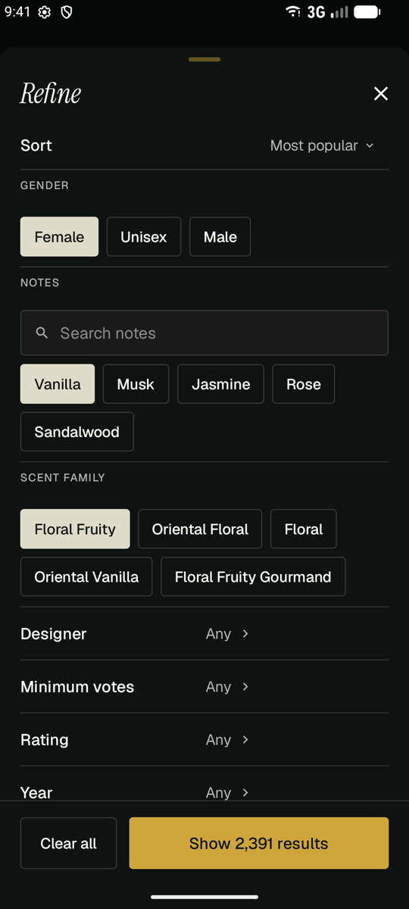
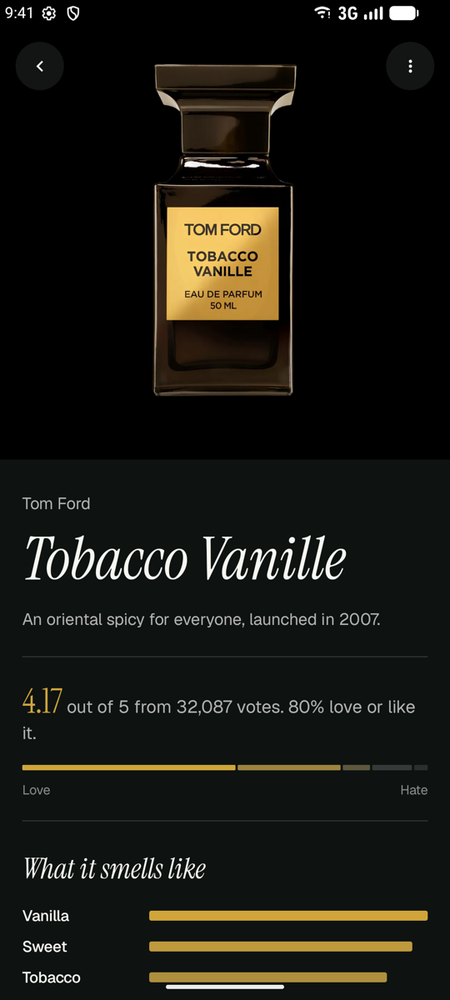
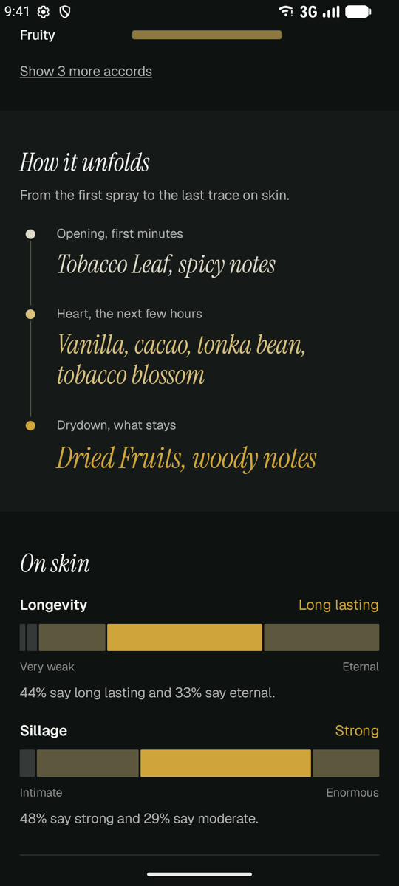
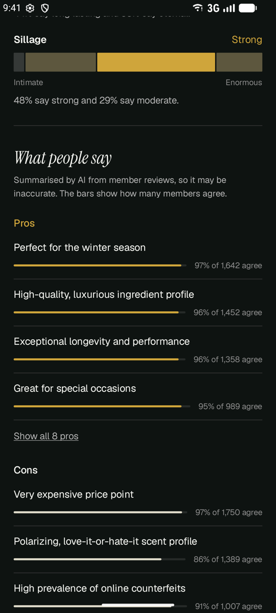
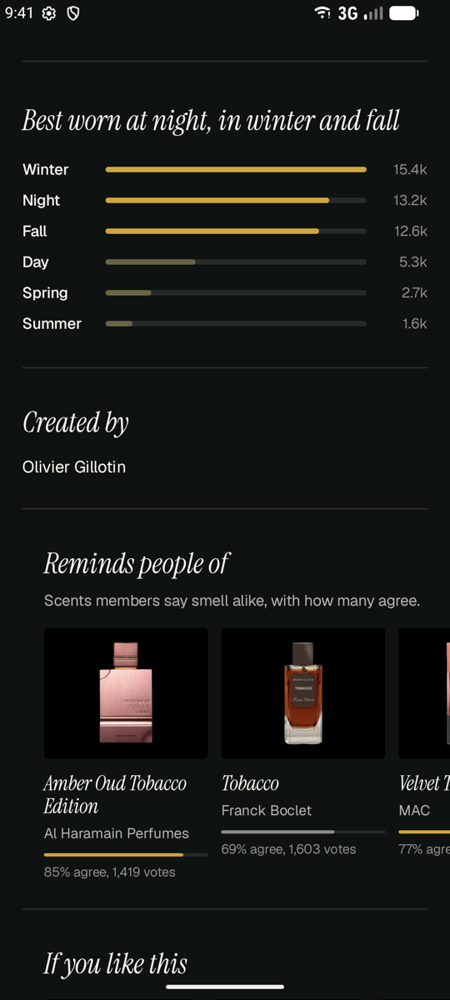

<div align="center">


# HyperFragz

**A calm, fast, ad-free way to browse Fragrantica on Android.**

Search 140,000+ perfumes, filter by notes, gender, family and designer, and read every perfume page in a clean dark layout without ads, pop-ups or clutter.

[](https://github.com/hystericmoon/hyperfragz/releases/latest)
&nbsp;


</div>

<br>

<table>
  <tr>
    <td align="center"><br><sub><b>The Index</b> · search and results</sub></td>
    <td align="center"><br><sub><b>Filter & sort</b> · notes, gender, family</sub></td>
    <td align="center"><br><sub><b>Perfume page</b> · rating and accords</sub></td>
  </tr>
  <tr>
    <td align="center"><br><sub><b>How it unfolds</b> · notes and performance</sub></td>
    <td align="center"><br><sub><b>What people say</b> · pros and cons</sub></td>
    <td align="center"><br><sub><b>Best worn</b> · seasons and look-alikes</sub></td>
  </tr>
</table>

## Features

- **Search everything.** The full Fragrantica catalogue, with results as you type.
- **Real filters.** Gender, notes, scent family, designer, perfumer, year, rating and minimum votes, with live result counts. Remove any filter with one tap.
- **Readable perfume pages.** Rating breakdown, main accords, the note pyramid ("How it unfolds"), longevity and sillage ("On skin"), community pros and cons, best season and time of day, similar scents and reviews.
- **Saved perfumes.** Tap the heart on any perfume to keep it in your Saved list, stored on your phone with no account needed.
- **Opens Fragrantica links.** Share a fragrantica.com link to HyperFragz, or let perfume links open straight in the app.
- **Fast.** Sections appear as soon as they're ready, usually within 2–3 seconds.
- **No ads.** Ad and tracker requests are blocked before they load.
- **Light on your phone.** Uses almost no CPU while idle and rests completely in the background.
- **Built-in updates.** HyperFragz checks GitHub for new versions and updates with one tap.
- **Accessible.** Large touch targets, TalkBack labels, and selected states that never rely on colour alone.
- **Escape hatch.** If something isn't covered, *Open on Fragrantica* shows the original page inside the app.

## Install

1. On your Android phone, open the [**latest release**](https://github.com/hystericmoon/hyperfragz/releases/latest) and download `HyperFragz-x.y.z.apk`.
2. Open the downloaded file. If Android asks, allow your browser or Files app to **install unknown apps**.
3. Tap **Install**, then open HyperFragz.

> Android may warn that the app comes from an unknown source. That's expected for apps installed outside the Play Store.

## Updating

When a new version is published, a banner appears at the top of **The Index**:

> HyperFragz 1.2.0 is available · **Update**

Tap **Update**. HyperFragz downloads the new version and Android asks you to confirm the install. The first time, Android asks you to allow HyperFragz to install apps; switch it on, go back and tap **Update** again. Your data stays put.

You can also check any time: tap **FRAGRANTICA** at the top right → **Check for updates**.

## How to use

| To… | Do this |
|---|---|
| Search | Type in the search field on The Index. |
| Filter | Tap **Filter & sort**, pick chips (gender, notes, family) or open a row (designer, rating, year…), then **Show N results**. |
| Remove a filter | Tap the × on its chip under the search field. |
| Change the order | Tap the sort label above the results (Most popular, Newest, Top rated…). |
| Open a perfume | Tap its card. Scroll for notes, performance, opinions, similar scents and reviews. |
| Sort reviews | In Reviews, open the sort menu: Newest, Most positive, Most negative. |
| Save a perfume | Tap the ♡ at the top of its page. Your saved perfumes are behind the ♡ next to **FRAGRANTICA** on The Index. |
| Open links in the app | Share any fragrantica.com perfume link → **HyperFragz**. To have links open in the app automatically: **FRAGRANTICA** → **Open Fragrantica links here** → turn on *Open supported links* and add the links. |
| Report a problem | **FRAGRANTICA** (or **⋮** on a perfume) → **Report a problem**. It opens a GitHub issue with the app version and page already filled in. |
| See the original page | Tap **⋮** on a perfume, or **FRAGRANTICA** on The Index → **Open on Fragrantica**. |

## How it works

HyperFragz is a native Android app (Kotlin, Jetpack Compose, Material 3). Behind the screens, a hidden WebView loads fragrantica.com like a normal browser would. Small scripts read the page and hand the data to the native screens, so search, filters and voting counts all come straight from the site. Nothing is scraped in bulk, prefetched or stored on a server.

- **UI:** Jetpack Compose, Material 3, Coil for images, Instrument Serif and Geist fonts
- **Data:** Android WebView + `androidx.webkit` document-start scripts (`app/src/main/assets/`)
- **Updates:** GitHub Releases API, Android package installer via `FileProvider`

## Build from source

Requires Android Studio (or JDK 17) and the Android SDK.

```bash
./gradlew :app:assembleDebug
```

The debug build installs as **HyperFragz Debug** next to the release build. Release builds are signed with a key kept outside the repo (`keystore.properties`, ignored by git).

## Publishing a release

1. Raise `versionCode` and `versionName` in `app/build.gradle.kts` and commit.
2. Tag and push:
   ```bash
   git tag -a v1.2.1 -m "What changed, in a few lines"
   git push origin main v1.2.1
   ```
3. The **Release** workflow builds a signed APK and publishes it. The tag message becomes the release notes. Everyone's app shows the Update banner on its next launch.

The workflow signs with the repository secrets `KEYSTORE_BASE64`, `STORE_PASSWORD`, `KEY_ALIAS` and `KEY_PASSWORD`.

## Disclaimer

HyperFragz is an unofficial, personal project. It is not affiliated with, endorsed by or connected to Fragrantica. All perfume data, ratings and reviews belong to Fragrantica and its community; the app only displays the public website in a different layout. Please support Fragrantica by visiting the site.

Fonts: Instrument Serif and Geist, both under the SIL Open Font License.
